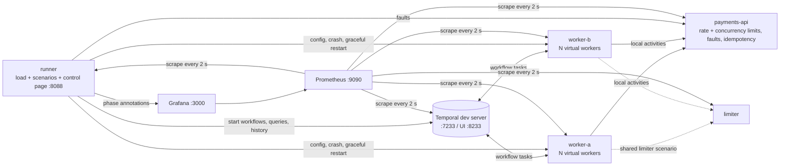

# Local Activity Lab (Java SDK)

The Java edition of the runnable companion to *Temporal Local Activities for Low-Latency Workloads*. It has the same architecture, scenarios, metrics and dashboards as the Go lab, built on the newest Temporal releases:

| Component | Version | Released |
|---|---|---|
| Temporal Java SDK (`io.temporal:temporal-sdk`) | **1.40.0** | 2026-09-29 |
| Temporal CLI dev server (`temporalio/temporal`) | **1.10.0** (bundles Temporal Server **1.32.2**) | 2026-11-03 |
| Java | 21 (virtual threads), Gradle 8.14.3, Eclipse Temurin 21 JRE | |

It runs:
- the guide's **worked sizing example** live;
- the **failure modes** from its table, each one broken first and then fixed;
- **Grafana dashboards** built on the metrics from its observability section, with alert thresholds drawn on the panels.

The Temporal "cluster" is the simplest one that works: the single-process dev server (`temporal server start-dev`, in-memory SQLite).

```
docker compose up --build -d
open http://localhost:8088      # control page: run scenarios
open http://localhost:3000      # Grafana (anonymous admin; admin/admin)
open http://localhost:8233      # Temporal UI
```

The first build downloads the Gradle dependencies from Maven Central, so it needs network access. Stop everything with `docker compose down`.

To build and test without Docker: `gradle test installDist`, then `build/install/lab/bin/lab api|limiter|worker|runner` with the same environment variables as in `docker-compose.yml`.

## What's running



| Service | Role |
|---|---|
| `temporal` | `temporalio/temporal:1.10.0` running `server start-dev`. |
| `payments-api` | A mock API with the guide's limits: a rate limit (token bucket) and a concurrent-request limit, both returning 429. Latency is lognormal (p50 40 ms, p99 150 ms), and it supports `Idempotency-Key`. It counts **duplicate side effects** and **idempotent replays**. The runner injects faults: slowdowns, outages, invalid cards, and 429 with a long `Retry-After`. |
| `worker-a`, `worker-b` | Two JVM worker processes (think "pods"). Each hosts several **virtual workers**. Every virtual worker has its own `WorkflowServiceStubs`, `WorkflowClient`, `WorkerFactory` and `Worker`, plus its own identity, local activity slots, per-worker rate cap and HTTP pool. SDK metrics carry `process` and `worker_id` tags. Each process also runs one activity-only worker for regular activities. |
| `limiter` | A fleet-wide token bucket (GCRA), standing in for the Redis or gateway limiter the guide recommends. |
| `runner` | The open-loop load generator and scenario engine. It records end-to-end latency, outcomes and query latency, and analyses a sample of workflow histories (heartbeats, timers, timeouts). |
| `prometheus`, `grafana` | Prebuilt dashboards in the *Local Activity Lab* folder. |

All five application roles are one Gradle `application` (`lab api|limiter|worker|runner|catalog`). They use the JDK's `HttpServer` and `HttpClient`, Jackson, and the SDK's tally scope, with no web framework.

### Scale

`SCALE` (default **0.2**) shrinks the load and the API limits together, so every ratio and every per-worker decision stays the same. `SCALE=1` is exactly the guide: 300 checkouts/s against 1,000 req/s and 200 connections. That is heavy for a laptop dev server; try it only on a big machine.

```
SCALE=0.1 docker compose up -d   # lighter
```

At the default scale the lab runs 60 checkouts/s against API limits of 200 req/s and 40 concurrent requests. The fleet is 8 workers minimum and 10 maximum, with 4 local activity slots and 20 req/s per worker.

## How the guide's settings map to the Java SDK

| Guide setting | Java SDK 1.40.0 | In this lab |
|---|---|---|
| Local activity slots per worker | `WorkerOptions.setMaxConcurrentLocalActivityExecutionSize`, or a `WorkerTuner` (`CompositeTuner` + `FixedSizeSlotSupplier` / `ResourceBasedSlotSupplier.createForLocalActivity`) | Fixed-size tuner; resource-based in the *Resource tuner* scenario |
| Per-worker local activity rate cap | **No SDK option.** `WorkerOptions.setMaxWorkerActivitiesPerSecond` limits regular activities only. | Token bucket (burst 1) inside the activity, so the wait **holds a slot and counts against StartToClose** |
| Fleet-wide rate cap | `setMaxTaskQueueActivitiesPerSecond` applies to regular activities only | Shared limiter service |
| Pollers | `PollerBehaviorSimpleMaximum` / `PollerBehaviorAutoscaling` (`setWorkflowTaskPollersBehavior`) | 5 fixed pollers per worker; local activities need none. Autoscaling skews the load: matching favours workers with more pollers, so busy workers scale up, win more tasks, and saturate their slots and rate cap |
| Attempt / overall budget | `LocalActivityOptions` `StartToClose` / `ScheduleToClose` | From the sizing plan |
| Slot-queue budget | `LocalActivityOptions.setScheduleToStartTimeout` (Go has no equivalent) | 500 ms in the *Slot exhaustion* fix |
| Local retry threshold | `LocalActivityOptions.setLocalRetryThreshold`, default **3 × workflow task timeout** | 30 s (10 s task timeout) |
| Draining on shutdown | `WorkerFactory.shutdown()` + `awaitTermination(timeout)` | 15 s, `stop_grace_period: 20s` |
| Metrics | `WorkflowServiceStubsOptions.setMetricsScope(tally Scope)` | Custom `StatsReporter`, Prometheus text on `:9090` |

## Dashboards

| Dashboard | Shows |
|---|---|
| **Worked sizing example** (home) | The guide's derivation table as planned-vs-measured stats, then limits and the latency budget. The *Worked sizing example* scenario steps the fleet 8 → 10 → 6 → 8 workers; at 6 workers the fleet's rate cap drops below demand. A Java-only panel shows the **per-worker token wait** inside the local activity. |
| **Failure modes** | An index of the scenarios, plus one dashboard per row of the guide's table. Each has a symptom/cause/fix panel, a phase timeline (blue baseline, red broken, green fixed) and the panels that show the symptom and the fix. |
| **Observability** | The guide's metrics table, each metric with its alert threshold as a red dashed line. It also shows API-side 429/5xx and a **pool waits** panel (client vs server latency: time that counts against `StartToClose` but appears in no Temporal metric). History-derived panels show markers and heartbeats. |

Every panel carries annotations: phase regions, plus red markers for crashes and graceful restarts.

## Scenarios

Run them from the control page. Each takes 2½ to 6½ minutes: broken configuration, recovery, then the fix.

| Scenario | Broken | Fixed | Watch |
|---|---|---|---|
| Worked sizing example | 6 workers (below the floor) | 8 and 10 workers | API req/s and in-flight requests under their limits; per-worker token wait at 6 workers |
| API slowdown | API 15× slower; StartToClose 10 s, ScheduleToClose 30 s, unlimited retries | 2 s budget, circuit breaker, "deferred" fallback | Workflow task latency, query latency, heartbeats; breaker state |
| Slot exhaustion | 1 slot per worker, API 3.5× slower, 30 s budget | Slots from Little's law, 2 s budget, **ScheduleToStart 500 ms** | Slots available = 0; end-to-end vs execution latency |
| Workflow task heartbeat | 10 s risk check as a local activity | Risk check as a regular activity | Heartbeats per workflow; query latency ≈ 8 s vs milliseconds |
| Pod loss | `kill -9` of worker-a (`Runtime.halt`) | Graceful stop (`shutdown` + `awaitTermination` 15 s) | p99.9 latency ≥ 10 s; workflow task timeouts |
| Duplicates | Crash with no idempotency keys | Crash with keys | Duplicate side effects vs idempotent replays |
| Fleet scale-out | 10 workers with caps sized for 6, demand 1.8× | Caps sized for 10; shared limiter | 429s (rate) at the API; fleet rate cap line |
| Retry storm | Outage: constant 250 ms retries, no cap, invalid cards retried | 4 attempts, `setDoNotRetry` for 4xx, breaker, fallback | API req/s by status (log scale); API calls per workflow |
| Long backoff | `Retry-After: 40 s` (above the 30 s threshold) honoured by the local activity | Fail fast, hand the step to a regular activity | Timers and workflow tasks per workflow |
| Long chain | 5 local calls, no checkpoint, crash | Checkpoint (`Workflow.sleep(1 ms)`) every 2 calls | Re-executed calls by step |
| Resource tuner | Resource-based local activity slots (`ResourceBasedController`, 90% CPU / 90% heap), API 8× slower | Fixed-size slots | Slots used vs API concurrency limit; concurrency 429s |

Not simulated: non-determinism from changing local activity code or options without versioning. That is a deployment issue, not a runtime one.

## Java SDK details this lab surfaced

These come from reading the `temporalio/sdk-java` v1.40.0 source. The scenarios depend on them.

- **Local retry threshold defaults to 3 × the workflow task timeout (30 s with the default 10 s), not 1 minute.** It is configurable per call with `LocalActivityOptions.setLocalRetryThreshold`. Below the threshold, retries run in process while the workflow task heartbeats. Above it, the SDK records a marker and starts a durable timer, so each retry costs a workflow task. The guide's "1 minute" is the TypeScript/Python/.NET default. The *Long backoff* scenario uses a 40 s `Retry-After` to cross the Java threshold.
- **No per-worker rate limit for local activities.** `setMaxWorkerActivitiesPerSecond` and `setMaxTaskQueueActivitiesPerSecond` apply only to regular activity polling. A per-worker cap must live in your code (this lab uses a token bucket in the activity) or in a shared limiter. Unlike Go's built-in limiter, an in-code wait occupies a slot and spends the attempt's `StartToClose`.
- **`ScheduleToStartTimeout` exists for local activities.** It bounds the time spent waiting for a slot, which Go cannot do, so slot starvation fails fast instead of eating the whole `ScheduleToClose`.
- **The workflow task heartbeat fires at 80% (4/5) of the task timeout.**
- **`nextRetryDelay` on `ApplicationFailure` is honoured by local activity retries.** That is how `Retry-After` is applied.
- **Graceful shutdown is `WorkerFactory.shutdown()` + `awaitTermination()`.** `shutdown()` stops polling and lets already-received tasks finish; `shutdownNow()` interrupts them. The worker's JVM shutdown hook does this on `SIGTERM`.
- **Defaults: 200 slots** each for workflow tasks, activities and local activities, and 5 pollers. A 200-slot default per worker against a 200-connection API is the guide's main misconfiguration risk.
- **Metric names** match Go (`temporal_local_activity_total`, `temporal_worker_task_slots_used{worker_type="LocalActivityWorker"}`, …). Through a Prometheus reporter, timers become `*_seconds` histograms and counters get `_total`. The lab's `PromStatsReporter` does exactly that, so the PromQL is the same as with the Go lab or Micrometer.

## Verification status

**Run end to end on 2026-11-07** (Docker Desktop on macOS, `SCALE=0.2`): all 20 tests pass against the real SDK (including `CheckoutWorkflowTest`), the stack starts cleanly, all 200 dashboard queries execute against live Prometheus, and all 11 scenarios show their broken-phase symptom and fixed-phase recovery. The baseline (8 workers, 60 checkouts/s) completes 100% of workflows with an end-to-end p50 of about 0.25 s and p99 of about 1.1 s.

The original, pre-run notes follow:

- **Versions confirmed** from GitHub releases and Docker Hub on 2026-11-06: Java SDK v1.40.0, Server v1.32.2, CLI v1.10.0 and the `temporalio/temporal:1.10.0` image.
- **All main sources compile with `-Xlint:all`, no warnings**, against stubs that copy the v1.40.0 signatures of every SDK class the lab uses, plus the real tally-core 0.13.0 and Jackson.
- **16 unit and integration tests pass** with the real code (everything except the SDK internals):
  - The API enforces its rate and concurrency limits, idempotency, duplicate counting, faults and the latency profile.
  - The limiter enforces its fleet-wide rate.
  - The activity follows the right call path and records metrics.
  - The circuit breaker and token bucket behave as specified.
  - `PromStatsReporter`, run under real tally, exports the right names and labels.
  - The scenario catalog is consistent.
  - Runner wiring works: fleet split, faults, limiter, crash → watcher re-apply, graceful restart, Grafana annotations, and the `/api/info` shape the control page uses.
- **`CheckoutWorkflowTest`** (`TestWorkflowEnvironment` against the real mock API: happy path, decline, outage → deferred, checkpoints) **compiles but has not been run**, because it needs the real SDK. `gradle test` runs it.
- **All 200 dashboard queries parse** with Prometheus v2.55.1's PromQL parser, and every SDK metric they reference exists in v1.40.0's `MetricsType`.
- **`docker compose config` validates**, and `build.gradle` parses under Gradle 8.14.3.
- **Not yet run end to end** (Gradle dependency download, Docker build, a live dev server). The scenario effects follow from the SDK source and the sizing arithmetic, but the exact numbers depend on your machine. If the build fails on an SDK signature, it will be in `lab/fleet/Fleet.java` (tuner and poller options), which is the most version-sensitive file.

## Troubleshooting

- **Everything is slow at baseline:** lower `SCALE`. The dev server is a single process. Scenarios that hold many workflows open (API slowdown, slot exhaustion) put real load on it, and so do eight JVM workers.
- **Panels show "No data" right after start:** histograms need ~30 s of traffic, and history-derived panels need completed workflows. Tally flushes to the registry every second.
- **Annotations missing:** the runner posts them to Grafana as `admin:admin`. Check `docker compose logs runner`.
- **More SDK logging:** set `JAVA_OPTS=-Dorg.slf4j.simpleLogger.defaultLogLevel=info` on a service.
- **Rebuild after code changes:** `docker compose up --build -d`.

## Layout

```
src/main/java/lab/
  Main.java            one binary: api | limiter | worker | runner | catalog
  sizing/Plan.java     the guide's derivation, from SCALE
  api/                 mock payments API
  limiter/             shared limiter
  app/                 CheckoutWorkflow + CallAPI activity (policy-driven), breaker, token bucket
  fleet/               virtual workers, tuners, control API, PromStatsReporter (tally -> Prometheus)
  runner/              load, scenarios, control page, Grafana annotations
  prom/, http/         tiny Prometheus registry and HTTP helpers
src/main/resources/lab/ui.html   control page
src/test/java/lab/     JUnit 4 tests (SDK test environment for the workflow)
grafana/               provisioning + generated dashboards
tools/                 gen_dashboards.py (+ catalog.json from `lab catalog`)
```

To regenerate the dashboards after changing scenarios, run `gradle installDist && build/install/lab/bin/lab catalog > tools/catalog.json && python3 tools/gen_dashboards.py`.
